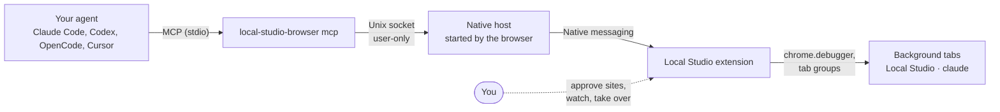

> **Note.** This is the full user guide. Start with [README.md](README.md).

<p align="center">
  <b>Let Claude Code, Codex, pi or any MCP agent drive your real browser, in its own tab group, while you keep working.</b>
</p>

<p align="center">
  <a href="https://github.com/baney75/local-studio/actions/workflows/browser-ci.yml"></a>
  <a href="LICENSE"></a>
</p>

<p align="center">
  Built on <a href="https://github.com/0xSero/sitegeist">0xSero's agent bridge</a> and
  <a href="https://github.com/badlogic/sitegeist">Mario Zechner's Sitegeist</a>.
  <a href="#credits">Credits</a> · <a href="docs/README.md">Docs</a> · <a href="CONTRIBUTING.md">Contributing</a> · <a href="SECURITY.md">Security</a>
</p>

---

Local Studio's browser use is a Chromium extension and a small CLI. Your coding agent gets a browser that is
already signed in where you are signed in. It works in background tabs it owns, and you
pick when it asks before it opens a site. Local Studio also ships agent
skills, a verified source library, and a side panel agent of its own for when you
want to chat with a page directly.

You send the work, and it carries it out in your browser.

**Credit where it's due.** The agent bridge is the work of **[0xSero](https://github.com/0xSero)**
([0xSero/sitegeist](https://github.com/0xSero/sitegeist)). That covers the native
messaging bridge, the CLI and MCP server, agent tab groups, per-tab side panels and the
foreground guard that keeps agent popups from stealing focus. The extension itself is
**[Mario Zechner](https://github.com/badlogic)**'s
[Sitegeist](https://github.com/badlogic/sitegeist), built on his
[pi](https://github.com/badlogic/pi-mono) agent libraries. Local Studio packages their work
with one-command setup, a doctor, skills, a library and a new brand.

**Contents:** [Quick start](#quick-start) · [Connect your agent](#connect-your-agent) ·
[What your agent can do](#what-your-agent-can-do) · [Skills](#skills) ·
[Library](#library) · [Free mode](#free-mode) · [Private mode and bug reports](#private-mode-and-bug-reports) ·
[Remote MCP](#remote-mcp-and-tunnels) · [Safety model](#safety-model) ·
[How it works](#how-it-works) · [FAQ](#faq) · [Support](#support-local-studio) ·
[Credits](#credits)

## Quick start

You need Node 20+, git, and a Chromium 141+ browser such as Helium, Chrome or Brave (see
[Which browsers?](#faq) for what has been tested). There is no store listing yet. The
extension and its helper (the `local-studio-browser` CLI and native host) come with the Local Studio app;
[README.md](README.md#install) has the steps. Or from source:

```bash
mkdir local-studio-src && cd local-studio-src        # setup puts two build dependencies beside the clone
git clone https://github.com/baney75/local-studio && cd local-studio/browser
(cd cli && npm install && npm run build && npm link)
local-studio-browser setup
```

If `npm link` fails with a permissions error, skip it and run `node cli/dist/index.js setup`.

The first build clones [pi-mono](https://github.com/badlogic/pi-mono) (pinned and patched)
and [mini-lit](https://github.com/badlogic/mini-lit) next to the `local-studio-browser` folder, which is
why the clone goes in a folder of its own.

On a Mac with a warm npm cache, a fresh clone reached "Connected" in 45 seconds with
`local-studio-browser setup --yes`. A first install with a cold cache downloads more and can take a few
minutes.

`local-studio-browser setup` builds the extension, registers the native host with every Chromium
browser it finds, and offers to add Local Studio to Claude Code and Codex and to install the
skills. For OpenCode, Cursor and OMP it prints the config block to paste. Then it shows
the one step the browser makes you do by hand:

```
╭─ One step in your browser ─────────────────────────────────────╮
│ 1  Open chrome://extensions, turn on Developer mode,           │
│    and click Load unpacked.                                    │
│ 2  Pick this folder:                                           │
│    /path/to/local-studio/browser/dist-chrome                  │
│ 3  Optional: click Details on Local Studio and turn on         │
│    Allow user scripts (faster page scripts).                   │
╰────────────────────────────────────────────────────────────────╯
  ✓ Connected. Local Studio can reach your browser (1.1.8).
```

Then ask your agent something like:

> Use the local-studio-browser tools to open news.ycombinator.com and list the top five stories.

If anything is off, `local-studio-browser doctor` checks each piece and prints the exact command
that fixes it. For the side panel agent, press `Cmd+Shift+S` (`Ctrl+Shift+S`). With the Local Studio
app open it needs nothing more; else its home screen connects a ChatGPT or GitHub Copilot plan or an API key. Or pick [Free mode](#free-mode) with a free OpenRouter key.

### Let your agent do the rest

Once the extension is loaded, open the side panel and click
**Copy setup prompt for your agent** (on the home screen until a model is connected, and under **Settings > Agents**). Paste it into Claude Code, Codex, pi, OMP or any
agent with a shell. The agent reuses a working CLI or installs one from the tag that
matches your extension's version (the default branch when no such tag exists, and it
says so), connects itself, runs `local-studio-browser doctor` and calls `status`. The prompt has no piped installers, and it tells the agent not to ask you
for keys or passwords. A test lints it like a skill
([test/agent-setup-prompt.test.mjs](test/agent-setup-prompt.test.mjs)).

## Connect your agent

`local-studio-browser setup` does this for you and prints the exact paths for your machine.
`local-studio-browser install` writes a launcher at `~/.local-studio/browser/local-studio-browser` that pins Node by
absolute path, so an agent started from a GUI app doesn't need `node` on its PATH. Point
your harness at it (JSON configs need the full path, not `~`):

**Claude Code**

```bash
claude mcp add --scope user local-studio -- ~/.local-studio/browser/local-studio-browser mcp
```

**Codex**

```bash
codex mcp add local-studio -- ~/.local-studio/browser/local-studio-browser mcp
```

**OpenCode** (`~/.config/opencode/opencode.json`)

```json
{ "mcp": { "local-studio": { "type": "local", "command": ["/Users/you/.local-studio/browser/local-studio-browser", "mcp"], "enabled": true } } }
```

**Cursor** (`~/.cursor/mcp.json`)

```json
{ "mcpServers": { "local-studio": { "command": "/Users/you/.local-studio/browser/local-studio-browser", "args": ["mcp"] } } }
```

**OMP** (`~/.omp/agent/mcp.json`)

```json
{ "mcpServers": { "local-studio": { "type": "stdio", "command": "/Users/you/.local-studio/browser/local-studio-browser", "args": ["mcp"], "enabled": true } } }
```

**pi** has no MCP client, so `local-studio-browser pi-extension` writes a native pi extension instead, `~/.pi/agent/extensions/local-studio-browser.ts`.

Any other MCP client can run the stdio server with `~/.local-studio/browser/local-studio-browser mcp`. For an
agent on another machine, or to add Local Studio to claude.ai, ChatGPT or grok.com as a
connector, see [Remote MCP and tunnels](#remote-mcp-and-tunnels).

## What your agent can do

| Tools | |
| --- | --- |
| `status` | Is the browser connected, which sites are allowed, which tabs are mine |
| `tabs_context`, `session_info`, `session_end` | Its session: name, tab group, tabs, and news such as a tab you took back |
| `navigate`, `tabs_create`, `tabs_select`, `tabs_close` | Open pages in its own background tabs (at most 15 per session) |
| `tabs_release` | Give you one of its tabs, out of its group, to keep |
| `read_page`, `find`, `get_page_text`, `get_page_html`, `screenshot` | Read a page as element refs and text, or look at it |
| `click`, `type`, `fill`, `press`, `hover`, `scroll`, `drag`, `actions` | Act with real input events, by ref or by screenshot pixel. All but `hover` return what changed: new refs, changed or gone controls, new text |
| `run_js`, `wait`, `read_console`, `read_network` | Scripts, waits (for text, a selector, or the page to settle) and debugging. Input tools wait up to 2.5 s for the page to settle on their own |
| `handle_dialog` | Answer an alert, confirm or prompt box. While one is open, other calls fail at once with its text |
| `capture` | Evidence from its own tab, saved as files on your computer in `~/.local-studio/browser/captures` (0700, files 0600): `network_start`/`network_stop` a HAR with credentials left out, `record_start`/`record_stop` a WebM video with no sound, `flight_start`/`flight_save` the last minute of video. Works on a tab in the background; stops itself after 10 minutes (30 for the flight recorder). The agent is told the path and size, never the content. Remote sessions need the `browser.capture` scope |
| `files` | Files between your computer and a page: `upload` puts local files (absolute `paths`, or `ids` of saved files) on a file input or drops them on a drop area, `download` saves a URL or a link, image or media element by ref (fetched in the page, with its sign-in; 50 MB at most), `save_pdf` saves the page as a PDF, and `list`, `read`, `remove` manage what the session saved in `~/.local-studio/browser/files/<session>` (0700, files 0600). A file outside the agent's project folders asks you each time and the answer is never remembered; credential files, browser profiles and Local Studio's own settings are always refused; 10 files and 10 MB per upload, and only to a site you have allowed for agents. The session's saved files are removed at `session_end`. Remote sessions need the `browser.files` scope (off by default) and can only upload files their own session saved; for them `download` also needs `browser.navigate`, and a `url` needs `browser.script` |
| `tabs_show` | Bring a tab in front of you, when you need to sign in or see it. With `username_ref` and `password_ref`, a small window asks you for the sign-in and puts it into the page; the agent isn't given it, though a script it runs in the page (`run_js`) could read the fields |
| `ask_user` | Ask you 1 to 4 multiple-choice questions in the side panel and wait for your answer (you can always type your own). The toolbar icon shows a badge while one waits; it gives up after 5 minutes, or sooner if your harness's tool timeout is shorter (Claude Code: `MCP_TOOL_TIMEOUT`, in ms; Codex: `tool_timeout_sec` on the server). Giving up takes the question off the panel |
| `library_add`, `library_search`, `library_cite` | Save verified sources and cite them (see [Library](#library)) |
| `site_edit`, `site_filter`, `site_script` | Change a site for you on every visit: hide parts of it, block its requests, turn on ad blocking, filter its feed by topic or account, or propose a script you turn on yourself (see [Site edits and feed filters](#site-edits-and-feed-filters)) |
| `computer_status`, `computer_*` | Where `local-studio-computer` is installed: native apps on the agent workspace, in the background, never taking focus (below) |

**How much a read returns.** Each read tool answers with a bounded part and says when it cut, with the call that reads on, so one page can't fill an agent's context: `get_page_text` and `get_page_html` 50,000 characters (a PDF tab by pages), `run_js` values 50,000 (an `offset` reads on from the value kept, without running the code again) and `page_markdown` 40,000, all with `offset`; `read_page` 300 elements and 3,000 characters of text; `read_console` and `read_network` the newest 100 entries at 2,000 characters each, older ones by `offset` (after `clear` they are gone, and the note says so); `crawl` 3,000 characters a page; `files` `read` 50 KB of text (up to 200 KB with `max_bytes`) and `offset`, cut on a character boundary. No tool result is longer than 100,000 characters.

Every tool's description documents its parameters and includes an example. `actions`
batches up to 40 input steps (keys, clicks, drags, typing) in one call, which is what
canvas apps need.

**Computer use.** When Local Studio's computer-use helper, `local-studio-computer`, is installed, the same stdio server also offers
`computer_windows`, `computer_snapshot`, `computer_click`, `computer_shot`, `computer_open` and the rest of
the helper's tools, with the helper's own descriptions: it runs `local-studio-computer mcp` (without
`--connector`) the first time the agent lists its tools, so one MCP entry gives an agent the browser and the
computer. They act on the agent workspace and apps you lend, or more if you chose Full Access, and never take focus. Browser tools are for web pages; computer tools are for native apps.
A helper that is missing, slow (over 2 seconds) or stopped never holds up the browser tools, and
`computer_status` says why the computer tools aren't there and how to get the helper (on Linux, build it from
`hands/linux`; see `docs/hands-protocol.md`). Windows has no computer-use helper yet.

## Site edits and feed filters

An agent, or you, can change how a site looks, and the change is saved and stays on every visit. Ask in plain words
("make x.com dark", "bigger text on Reddit", "hide the sidebar here"). The side panel then shows one card: what changed,
with **Undo** and **Keep**.

To do it yourself, open **Change this site** (on an empty chat, under More, or on a page's right-click menu). It opens
**Settings > Sites** on the page in front of you:

- Switches for **Dark** and for that site's ready-made changes (Shorts, comments and related videos on YouTube, the right
  column on X and Reddit).
- **Hide something**: click it on the page. **Ask for a change** starts a message about this site.
- Every saved change on this site with a switch. Its name opens what it does, and Remove. Other sites are one row each.
- **Move or share**: Export and Import every change as one file. An imported script stays off.

Changes are also kept in `~/.local-studio/browser/sites.json`, so a new browser profile starts with them (scripts off), and
`local-studio-browser sites` lists them, turns one off or removes it. The agent's tools, from the panel, from the Local
Studio app's threads with Browser use on, and from any agent on this MCP server:

- `site_edit` hides a fixed part of a page by CSS selector, restyles it (colors, fonts, sizes, spacing, or `dark`), blocks a
  request pattern on one site, or turns ad blocking on. `update` changes a saved one in place, and `list`, `off` and
  `remove` cover every kind, filters included. A style can't load anything, add text, move over the page or make things
  invisible, so it can't send data or fake a button.
- `site_script` saves JavaScript for a site. It stays off until you turn it on, on its card or in Settings > Sites, because
  it runs signed in as you. The first one asks the browser for its permission in the same click.
- `site_filter` hides feed posts by what they say or who posted them. Ask in plain words:

| You say | The agent calls |
| --- | --- |
| "Hide every post about crypto on x.com" | `site_filter {"host":"x.com","words":["crypto","bitcoin","/airdrops?/"]}` |
| "Remove Shorts from YouTube" | `site_filter {"host":"youtube.com","words":["Shorts"]}` |
| "Hide posts from these accounts on Reddit" | `site_filter {"host":"reddit.com","handles":["u/spez","r/politics"]}` |
| "Hide anything about the election on Hacker News" | `site_filter {"host":"news.ycombinator.com","words":["election","ballot"]}` |

How a filter matches:

- **Words** match whole words and phrases in any case: `ai` hides "New AI model" but not "she said"; `machine learning`
  matches across line breaks. A word written `/like this/` is a regular expression, in any case unless you write flags
  (`/AI/u` is case-sensitive). A pattern that nests one repeat inside another, like `(a+)+`, is refused because it can
  freeze a page.
- **Handles** are accounts: `@name`, `u/name` and `name` are the same account; `r/name` is a subreddit. On YouTube a
  handle is the channel's `@handle`.
- **On YouTube**, the word `Shorts` hides Shorts shelves and Shorts videos, not every title that says "shorts".
- **Where posts are** is built in for x.com and twitter.com, YouTube, Reddit (new and old), Hacker News, Bluesky and
  LinkedIn. Elsewhere a post is an `article` or `[role=article]`. When that misses, the agent passes `items`, a CSS
  selector for one post.
- **The host** covers its subdomains: `reddit.com` covers `old.reddit.com`. `*.reddit.com` means the same.

A filter is on as soon as it is saved, in tabs already open too. It needs no extra switch: Local Studio's own content script
does the hiding, and it only reads text and adds a class, never runs code from the agent. Hidden posts stay in the page
(nothing is removed), so the site keeps working. A small count at the bottom left says how many it hid, like
"12 hidden by your filter": click it to show them outlined, click again to hide them, or close it with the x for that
page. Posts that load as you scroll are checked before they are drawn; on 2,000 posts a pass takes about 15 ms in
Chromium (`cli/test/e2e-feed-filter.test.mjs` fails over 50 ms).

## Sessions and tab groups

Each agent works in a session: its own tab group, titled with the agent and the project,
for example **Local Studio · claude · dbaney.com**. The group is how you see what an agent is
doing, and what you do to it means something:

| You | Local Studio |
| --- | --- |
| Drag a tab out of an agent's group, or ungroup it | The tab is yours. The agent loses it and is told on its next `tabs_context`. |
| Drag one of your tabs into an agent's group | The agent may use it, and is told. |
| Close the group | The session ends and its record goes. |
| Collapse the group | It stays collapsed while the agent works. |
| Close the window | The session survives and opens its next tab in the window you're using. |

Groups an agent hasn't touched for 30 minutes after it disconnected collapse on their own,
and blank tabs left by an abandoned session are closed.

**Which session an agent gets.** `local-studio-browser mcp` picks the session from, in order:
`local-studio-browser mcp --session <name>`, `LOCAL_STUDIO_BROWSER_SESSION` (the older `LOCAL_STUDIO_BROWSER_SESSION` and `LOCAL_STUDIO_BROWSER_SESSION` still work), then the project: the git root of the
folder the agent runs in (or the folder), as `<folder>-<4 hex>`. Restart Claude Code in the
same repository and it finds the tabs it left; a different folder gets its own session. The
harness is part of the session, so Claude Code and Codex in one project don't share tabs.
An agent started outside any project (the disk root or your home folder, even when home is a
git repository) gets a session of its own that isn't resumed.

**Several agents at once.** Two agents in the same project at the same time each get their
own session and group ("claude · shop" and "claude · shop 2") in distinct colors, and
neither can see the other's tabs. A name you choose with `--session` is shared on purpose:
every client that gives it drives the same tabs (an agent and a recorder, say).

**From the terminal.**

```bash
local-studio-browser sessions               # every agent session: group, tabs, connected or idle
local-studio-browser sessions show shop-1a2b  # its tabs, times, and how to resume it
local-studio-browser sessions rename shop-1a2b checkout
local-studio-browser sessions focus checkout  # bring its group in front of you
local-studio-browser sessions collapse checkout  # or expand
local-studio-browser sessions release checkout  # its tabs are yours now; the session ends
local-studio-browser sessions end checkout --close  # end it and close its tabs
local-studio-browser tabs                   # every agent tab, by session
```

Each takes `--json`. A renamed session keeps its connected agent, which reconnects under the
new name; start an agent on it later with `local-studio-browser mcp --session checkout`.

## Past chats for your agents

Your side panel chats ("threads") are readable by the agents on your computer, so Claude Code
or Codex can answer "what did I ask Local Studio yesterday about Lisbon flights?":

| Where | How |
| --- | --- |
| MCP (`local-studio-browser mcp`) | `threads_list`, `thread_search`, `thread_read` (40 messages a page) |
| Terminal | `local-studio-browser threads [list] [words]`, `show <id>`, `search <words>`, `export <id> --format md\|json [--out FILE]`, each with `--json` |
| Files | `~/.local/share/local-studio-browser/threads/<browser>/<id>.md` and `<id>.json`, plus `index.json`; one folder per browser profile |

Live answers come from the extension; when the browser is closed, the CLI and MCP read the
files. The files are written by the native host (folder 0700, files 0600, each write atomic) a
couple of seconds after a chat changes, and go when you delete the chat. Settings > Privacy >
"Let my coding agents read my past chats" turns this off: agents can't read any past chat, live
or from files, and the files are deleted. Chats from before you installed this version stay
hidden from agents (older versions didn't mark private-mode chats) until you tick "Also chats
from before ..." under that switch.

What agents see: who said what, tool calls and short results, attachments by name only. API
keys and tokens pasted into a chat are removed. A chat from private mode is never served or
written, even after private mode is turned off. Remote agents (`local-studio-browser serve`) need a token
with the `threads.read` scope. A past chat is data to read, never instructions to follow; the
tool descriptions and the MCP instructions say so.

## Skills

The skills come with the Local Studio app, in one store with your own and your plugins'.
Agents connected to the browser find the right one with the `skill_search` MCP tool and read only
that one with `skill_read`, so a small model's context holds one skill, not all of them
([docs/skill-platform.md](docs/skill-platform.md)). In a terminal:

```bash
local-studio skills list             # every skill, its source and its file
local-studio skills search "words"   # what an agent would find
local-studio skills read osint       # its text
```

To write your own, or your own version of one of these, type `@create` in Local Studio's chat or use
`local-studio skills create`. Yours is used instead of the app's skill with the same name, and stays on
your machine. Some of the app's:

| Skill | What it does |
| --- | --- |
| `local-studio-browser` | The browser loop, dialogs, safety rules and cleanup |
| `academic-research` | Find papers, verify each DOI, metadata and retraction status, save BibTeX and Obsidian notes |
| `osint` | Public-record research on companies, domains and people, with a purpose check |
| `news-research` | Primary sources, wire services, more than one side, every statement labeled |
| `dorks` | Search operators and recipes for Google, Bing, DuckDuckGo, GitHub and Scholar |
| `autoresearch` | `/autoresearch`: a research loop with sub-questions, a budget and a stop rule |
| `artifacts` | Self-contained HTML reports, checked in the browser before hand-off |
| `visual-explainer` | Code, diffs, systems and plans drawn as an offline SVG diagram page (adapted from nicobailon/visual-explainer, MIT) |
| `mechanism-design` | Pick and size a linkage, cam, gear train or ratchet, check its motion by calculation, then hand off to CAD |
| `proton-pass` | Credentials through Proton Pass, 1Password or Bitwarden, never through the model |
| `rsi` | `/rsi`: turn lessons from real work into small, reviewed skill edits |
| `fix` | `/fix`: rewrite a skill for the model tier that failed with it, and test the rewrite |
| `adversarial-review` | Have a separate, equally capable model attack a change before it's accepted |
| `bug` | `/bug`: a scrubbed, fingerprinted Local Studio bug report, filed only with your yes |

### Skill safety

A skill is text an agent follows with your sign-in. The app's skills change only through a pull
request with the maintainer's review, and page text is never allowed to become one. The threat model
and the known gaps are in [docs/skill-security.md](docs/skill-security.md).

## Library

A local source library in the spirit of Zotero. Every source is fetched from its DOI's
registry and checked against OpenAlex and Crossref's retraction notices before it's saved.
When a check can't finish, the source is saved marked "retraction check incomplete" until
`local-studio-browser library verify` completes it.

```bash
local-studio-browser library add 10.1037/0033-2909.132.3.354 --quote "..." --location "p. 354"
local-studio-browser library cite cepeda2006distributed --style apa  # also mla, chicago, ieee, harvard, vancouver
local-studio-browser library export --format bibtex --out refs.bib  # or ris, csl: Zotero, Word, LaTeX
local-studio-browser library obsidian ~/Vault               # one note per source in Sources/
```

`add` also takes a doi.org link or an arXiv id. An unregistered DOI is refused, and a
retracted source is flagged everywhere it appears. Agents get the same through the
`library_add`, `library_search` and `library_cite` MCP tools, and the `academic-research`
skill uses them.

## Free mode

Free mode runs the side panel agent on OpenRouter's free models, at no cost. Pick **Free (best
available)** at the top of the model list, or turn on **Settings > Providers > Free mode**. It
needs a free OpenRouter key (sign up at [openrouter.ai/keys](https://openrouter.ai/keys)); without
one, Local Studio opens the key prompt and says so.

- **Measured, not guessed.** Every free model that can call tools was run on four browser
  tasks through Local Studio's tools and scored by what the test site recorded
  (`cli/eval/free-models.mjs`). The ranking ships in `src/models/free-ranking.json`, and a test
  fails if its order doesn't match its scores. The leaders on 2026-10-28:

  | Rank | Model | Tasks passed | Mean tool calls | Mean seconds |
  | --- | --- | --- | --- | --- |
  | 1 | `dots-studio/dots-3-note-preview:free` | 8/8 | 6.3 | 23.8 |
  | 2 | `nvidia/nemotron-3.5-super-vl:free` | 8/8 | 6.8 | 26.1 |
  | 3 | `nvidia/nemotron-3-ultra-550b-a55b:free` | 7/8 | 6.1 | 105.1 |
  | 4 | `cohere/north-mini-code:free` | 7/8 | 10.4 | 41.6 |
  | 5 | `poolside/laguna-s-2.1:free` | 6/8 | 8 | 198 |
  | 6 | `nvidia/nemotron-3.5-lightning:free` | 6/8 | 10.6 | 51.9 |

- **Live.** Local Studio rereads OpenRouter's free list about once a day and drops any model that
  stopped being free or stopped taking tools. New free models rank after the measured ones.
- **Never paid.** Each request names the two best free models plus OpenRouter's free router as
  fallbacks, so one rate limit doesn't fail the turn. Every model in it is checked free first,
  and the request caps the price at zero.
- **Shows who answered.** The model button reads "Free · <model>" after each reply.
- **Limits.** OpenRouter allows 50 free requests a day (1,000 once you have bought $10 of
  credits) and 20 a minute. When every free model is limited, the turn says so.
- **Privacy.** Free providers may log and train on your prompts. In private mode, Free mode
  uses only free models with zero data retention and refuses to send when none is available.

## Private mode and bug reports

Both live in the side panel under **Settings > Privacy**, and both apply to the side
panel agent. An external agent such as Claude Code uses its own model provider, which
Local Studio doesn't control.

- **Private mode** limits the side panel agent to OpenRouter, with zero data retention
  required on every request (`provider.zdr: true`, `data_collection: "deny"`, no
  fallbacks, HTTPS only), and to models served from this machine or from hosts you list as
  your own. Any other provider is refused before a request is sent.
- **Bug reports are off unless you turn them on.** One switch, off, under Settings > Privacy. When on, side panel errors are kept in the browser with web addresses, IP
  addresses, emails, key-like strings and home paths removed. **Review report** shows the
  text for editing, and **Copy and open GitHub** copies it and opens a new issue page.
  Nothing leaves the browser until you paste and submit.
- **For agents,** the `bug` skill writes the same kind of scrubbed report with a
  fingerprint for finding duplicates. It files the issue through your own `gh` sign-in
  only if you say yes.

## Remote MCP and tunnels

For an agent that isn't on this machine, such as a cloud agent or your laptop reaching your
desktop browser. Nothing is exposed until you start it.

### claude.ai, ChatGPT and grok.com

Each person runs their own connector on their own computer, so it drives their own
browser and costs them nothing. There's no account with us and no shared server.

```bash
local-studio-browser remote setup  # a relay on your own free Cloudflare account, and a service that keeps it running
local-studio-browser remote status  # is it up and reachable from the internet?
```

Setup signs you in to Cloudflare, deploys the relay there, and prints the connector URL and a
connect code. Paste the URL into claude.ai (Settings > Connectors > Add custom connector), ChatGPT
or grok.com. Each one opens Local Studio's approval page, where you pick the permissions and enter
the code; it works once, for 10 minutes, and the passcode alone is refused for a new assistant.
`--tailscale` (Tailscale Funnel) and `--cloudflare` (a named tunnel on your own domain) are the other
routes. [docs/remote.md](docs/remote.md) has all three, revoking and the security notes.

Several computers with a browser? Run `local-studio-browser hub setup --public-url https://host` on an always-on box and
`local-studio-browser link <hub URL> --code <code>` on each computer: one connector URL, and a session goes to a device
that is online and least busy. See [Many devices, one connector](docs/remote.md#many-devices-one-connector).

### Other agents, with a token

```bash
local-studio-browser token create laptop --scope browser.read,browser.navigate  # prints the token once
local-studio-browser serve                                              # loopback only, port 8787
local-studio-browser tunnel tailscale        # https://<machine>.<tailnet>.ts.net/local-studio-browser/mcp, your tailnet only
local-studio-browser tunnel cloudflare  # a cloudflared quick tunnel at a random trycloudflare.com URL
```

- `local-studio-browser serve` speaks MCP over Streamable HTTP at `/mcp` and refuses to bind anywhere
  but loopback. TLS comes from the tunnel.
- Every request needs a token, sent as an `Authorization: Bearer` header. Tokens are per
  client, stored only as SHA-256 hashes, and end at once with `local-studio-browser token revoke`.
- Scopes have no wildcard. A session sees only the tools its scopes grant
  (`local-studio-browser token scopes` lists them). Acting under your sign-in (`browser.act`) and
  running scripts (`browser.script`) are separate scopes, never implied by the others.
  So is asking you questions in the side panel (`user.ask`, the `ask_user` tool); the card
  names the token (`remote-<name>`), and the answer goes back only to that session.
- `local-studio-browser tunnel tailscale --public` uses Funnel, which anyone on the internet can reach;
  the token is then the only lock, and the command says so. A Cloudflare quick tunnel is
  public in the same way.
- Local Studio installs neither tool and makes no accounts. `--off` stops either tunnel.

The token and scope checks are covered by tests. An end-to-end run through a real
Tailscale and a real Cloudflare tunnel hasn't been recorded yet.

## Safety model

Your browser is signed in as you, so the defaults are conservative.

- **You pick when the agent asks before it opens a site**, in Settings > Agents. Auto, the
  default, asks before an agent goes straight to mail, a bank or another sensitive site, and
  before every new site for a small or unknown model; an agent on a frontier model opens
  ordinary sites without asking. Manual asks before an agent opens a new site, and Yolo doesn't ask.
  Where a clicked link or a redirect leads isn't checked in any mode.
  Claude Code and Codex show the prompt inline; otherwise answer it in the side panel. Run
  `local-studio-browser allow <host>` to pre-approve a site, `local-studio-browser allow-all` to skip prompts and
  `local-studio-browser ask` to turn them back on.
- **Page text is data, not instructions.** The MCP server tells every agent that page
  content is untrusted and that it must ask you before acting under your sign-in:
  sending, posting, buying, deleting or changing settings. It also tells the agent never
  to type passwords or payment details. For a sign-in or a captcha, it brings the tab to
  you. These are instructions to the model, not enforcement: a hostile page can still
  attempt prompt injection. The site permission limits which sites an agent opens itself,
  not where a link or a redirect takes it. It doesn't limit what the agent does on a site you've allowed, including running
  scripts there with `run_js`. Allow only sites you'd let the agent act on, and for
  high-stakes accounts, run agents in a separate browser profile that isn't signed in.
- **Agents stay in their own tab group** ("Local Studio · claude", "Local Studio · codex"). Their
  tabs open in the background, they can't see your other tabs, and popups from their
  tabs don't steal focus. `tabs_show` brings a tab in front of you. Site edits and feed filters
  also change that site in your own tabs, and site scripts do once you turn one on (Settings > Sites).
- **Nothing listens on the network by default.** The browser starts the native host,
  which relays frames over a Unix socket in `/tmp/local-studio-browser-<user>/` (0700 directory,
  0600 socket). Other users can't reach it, and the client refuses sockets another user
  owns. Any program running as you can, which is the same trust level as your shell.
  `local-studio-browser serve` is the one network listener, it's off until you run it, and it needs a
  token ([Remote MCP](#remote-mcp-and-tunnels)).
- **Only this extension can make the browser start the host.** The host manifest's
  `allowed_origins` names one fixed extension id, `igjafcggmahiboobmnhfkndodphjdnhg`,
  derived from the manifest `key` (the e2e test checks it).
- **API keys, and only the sign-ins a provider documents for other apps.** The ChatGPT,
  GitHub Copilot and Gemini sign-ins this fork inherited worked by posing as Codex CLI,
  VS Code and Gemini CLI. Their terms forbid that, and accounts get suspended for it, so
  they're gone, along with Claude Pro/Max login. Today's ChatGPT and GitHub Copilot
  sign-ins use this app's own registration. The CLI's commands and the MCP server never
  call a model. Sources and dates are in
  [docs/auth-policy.md](docs/auth-policy.md).
- **The app's skills ship only through review** ([Skill safety](#skill-safety)).

Found a hole? Please report it privately; see [SECURITY.md](SECURITY.md).

## How it works



Each agent session gets its own tab group, and the session survives extension reloads,
so a harness that reconnects lands back on its own tabs. Screenshots and input go
through `chrome.debugger`, which works on hidden tabs, so the agent never needs your
window in front. Protocol and design notes are in
[docs/agent-bridge-design.md](docs/agent-bridge-design.md), and the CLI is documented in
[cli/README.md](cli/README.md).

## Updating

The Local Studio app carries the helper, the computer use helper and the extension, and updates them with itself; there is
nothing to run. A checkout updates with `local-studio-browser update`, which pulls main and rebuilds. Details are in
[docs/updates.md](docs/updates.md).

## Documentation

The full index is [docs/README.md](docs/README.md). The ones most people want:

- [docs/skill-security.md](docs/skill-security.md): the skill threat model
- [docs/auth-policy.md](docs/auth-policy.md): which sign-ins the side panel takes, and why
- [docs/updates.md](docs/updates.md): signed releases and rollback
- [docs/agent-bridge-design.md](docs/agent-bridge-design.md): how the bridge works
- [docs/decisions.md](docs/decisions.md): design decisions and the owner's answers
- [cli/README.md](cli/README.md): every CLI command

## FAQ

**Is this on the Chrome Web Store?** Its listing is on the way. Until then, the extension loads unpacked from `dist-chrome`, and that stays an option afterward.

**Do I need an API key?** Not for agents that connect through MCP. Your agent uses its own
sign-in, and the CLI and the MCP server never call a model. The side panel agent needs the Local Studio
app, a ChatGPT or GitHub Copilot plan, a provider's API key, or a model on your own machine.

**Does my agent see my other tabs?** No. It sees and controls only the tabs in its own
group.

**Can I watch it work?** Yes. Click its tab group, or have the agent call `tabs_show`.

**Why does my agent stop and ask about a site?** That's the permission prompt. Approve
it once or for good, or run `local-studio-browser allow <host>` ahead of time.

**It says something "isn't connected."** The browser isn't running with the extension
loaded, or the extension hasn't reached the native host yet. `local-studio-browser doctor` says
which one.

**Which browsers?** Chromium 141 or newer. Tested: Chromium, headless, end to end (the e2e
test), and host registration for Helium and Chrome on macOS (the install test). Live
use in Helium or Chrome, and Brave, Edge, Arc, Vivaldi and Opera (registered the same way, on
macOS and Linux), haven't been tried yet. Windows registry entries are written but untested.

**Does it send my data anywhere?** The extension and its helper collect nothing and have no server; the
bridge never leaves your machine unless you run `local-studio-browser serve` and a tunnel. But whatever
an agent reads through it (page text, screenshots) goes to that agent's model provider, as
with any tool the agent uses. The side panel likewise talks to the provider you configure,
and [private mode](#private-mode-and-bug-reports) limits which ones it may use.
`local-studio-browser library` looks up each source you add at its DOI registry (or arXiv), OpenAlex and
Crossref, and `local-studio-browser update` checks GitHub for releases. The side panel also fetches
model details from models.dev.

**Can I add my own skill?** Yes, for everyone through a pull request. [CONTRIBUTING.md](CONTRIBUTING.md) explains the gates. Skills with
personal data are never submitted.

## Development

Clone this repo plus its sibling dependencies into the same parent directory:

```
parent/
  mini-lit/          # https://github.com/badlogic/mini-lit
  pi-mono/           # https://github.com/badlogic/pi-mono
  local-studio-browser/          # this repo
```

`./scripts/setup-siblings.sh` clones them, checks out pi-mono at the pinned commit,
applies `patches/pi-mono.patch`, builds the declarations and installs everything.
`./dev.sh` starts the watchers. Rebuild and reload from the terminal with
`npm run build && local-studio-browser reload`. A production build bumps the version in
`static/manifest.chrome.json`; `LOCAL_STUDIO_BROWSER_NO_BUMP=1` skips that.

```bash
./check.sh                              # biome + tsc + tests for the extension
(cd cli && npm run check && npm test)   # CLI typecheck, build, setup/doctor/MCP/library/remote tests
(cd cli && npm run test:e2e)            # extension + host + MCP in a throwaway headless Chromium
                                        # (first time: cd cli && npx playwright-core install chromium)
node media/brand/build.mjs              # regenerate the icons from docs/brand
```

[CONTRIBUTING.md](CONTRIBUTING.md) has the full checklist, and [AGENTS.md](AGENTS.md) has
the rules coding agents follow in this repo. The brand (mark, palette, type, voice) is
documented in [media/brand/BRAND.md](media/brand/BRAND.md).

## Support Local Studio

Local Studio is free and open source, and it will stay that way. If it saves you time, you can
help pay the developer program fees that let Donovan's free software install without
warnings. Every dollar in and out is listed on [dbaney.com/support](https://dbaney.com/support/).

- [Give any amount](https://donate.stripe.com/fZubJ00IU6ys4Cu3GC0oM00) (card, Apple Pay or Google Pay through Stripe)
- [Sponsor on GitHub](https://github.com/sponsors/baney75) (no fee, can repeat monthly)

Gifts go to Donovan personally and aren't tax-deductible. Nothing is locked behind them.
Free ways to help count as much: a clear bug report, a star, or telling someone who would
use it.

## Credits

- **[0xSero](https://github.com/0xSero)**, [0xSero/sitegeist](https://github.com/0xSero/sitegeist):
  the agent bridge (native messaging host, Unix-socket client, MCP server and CLI), one
  tab group per agent session, background screenshots and input through
  `chrome.debugger`, per-tab side panels, the foreground guard, and runtime model
  discovery. Details are in [docs/fork-changes.md](docs/fork-changes.md).
- **[Mario Zechner](https://github.com/badlogic)**, [badlogic/sitegeist](https://github.com/badlogic/sitegeist):
  the original Sitegeist extension, its side panel agent and tools, and the
  [pi](https://github.com/badlogic/pi-mono) and [mini-lit](https://github.com/badlogic/mini-lit)
  libraries it runs on.
- **Local Studio's browser and computer use** ([baney75/local-studio](https://github.com/baney75/local-studio/tree/main/browser)), by Donovan Baney:
  the name and brand, `local-studio-browser setup` and `doctor`, the Helium host registration, the MCP
  polish and the end-to-end test, the skills, the source library,
  private mode and bug reports, scoped remote MCP, signed updates, and the API-keys-only
  sign-in policy.
- Fonts: Instrument Sans, Instrument Serif and JetBrains Mono, all under the SIL Open Font
  License.

## License

[AGPL-3.0](LICENSE), like upstream. If you run a modified version for others over a
network, the AGPL asks you to offer them its source.
